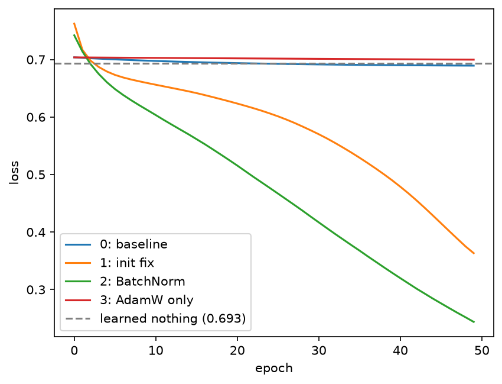

# Making Training Work

Diagnosing and fixing a network that would not train, one change at a time.

## Setup

python -m venv .venv
source .venv/bin/activate # Windows: .venv\Scripts\activate
pip install -r requirements.txt

## Run

Open `Lab2.ipynb` (next to the unmodified `lab02_starter.py`) and run all cells top to bottom. It reproduces the failure, prints the per-layer diagnosis, trains every fix stage, and plots all loss curves together (`stage_comparison.png`).

## Diagnosis

BrokenNet suffers from dying ReLU. Its bias of -2 pushes almost every value below zero, so ReLU outputs 0: only 7% of values pass layer 1 and 0% pass layers 2 to 8. After one backward pass, the mean absolute gradient is exactly 0 in all 8 hidden layers, so none of them can learn. Only the output layer's bias still changes, which is why the loss creeps down slightly to about the "learned nothing" value (ln 2 = 0.693).

## Stages and results

Each stage changes exactly one thing from the baseline (seed 0, 50 epochs, full batch).

	Stage 0 (baseline): final loss 0.6893
	Stage 1 (+ initialization): final loss 0.3632, Kaiming initialization for the weights and zero biases (instead of -2).
	Stage 2 (+ normalization): final loss 0.2437, BatchNorm before every ReLU, with BrokenNet's original initialization kept.
	Stage 3 (optimizer only, AdamW): final loss 0.6997, AdamW (lr 0.001) instead of SGD (lr 0.1), with nothing else changed.

## Conclusion

BatchNorm mattered most (0.2437). It re-centres each layer's values around zero before the ReLU on every batch, which cancels the constant -2 shift, so about half the units pass values and gradients again even with the bad initialization. The initialization fix removes the cause instead and also trains (0.3632), but more slowly within 50 epochs. Changing only the optimizer did nothing (0.6997): every optimizer builds its update from the gradient, and a gradient of exactly zero gives AdamW nothing to work with. It ended slightly above the baseline because its smaller learning rate moves the output bias more slowly.

## Known limitations

- One seed only; the gap between stages may change with other seeds.
- Training loss only, on the full training set; there is no held-out set.
- 50 epochs per stage; with more epochs, the init-fix stage might catch up with BatchNorm.
- No stage combines the two fixes, and no learning-rate schedule was tested.
